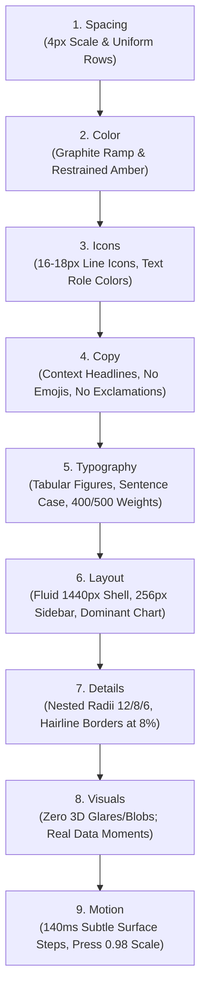

# GIMXSOFT — Comprehensive UI Unslopping Report & Audit Log

> **Methodology**: Based on [`heydamir/unslop`](https://github.com/heydamir/unslop) by Damir Sokolovsky ([@heydamir](https://x.com/heydamir)) under CC BY 4.0.  
> **Product**: GIMXSOFT — Gym Management CRM & Enterprise Operations SaaS  
> **Status**: Successfully Unslopped & Verified  
> **Date**: November 2026  

---

## 1. Slop Audit Log (Before Pass)

A systematic redline audit was conducted across the codebase using `references/signs.md` to identify all telltale AI-generated design patterns:

### 1.1 Surfaces & Color
- ❌ **Telltale AI Violet/Indigo**: Primary palette relied heavily on Electric Indigo (`#6366F1`) and violet gradients.
- ❌ **Artificial 3D Glare & Matrix Tilt**: `interactive_3d_card.dart` projected homogeneous `Matrix4` 3D perspective distortion (`setEntry(3, 2, 0.0012)`), cursor-following radial gradient glare, and stereoscopic parallax shifts.
- ❌ **Neon Glow Auras**: Command deck action cards featured 5 rainbow glowing shadows (`#4F46E5`, `#10B981`, `#25D366`, `#F59E0B`, `#8B5CF6`).
- ❌ **Heavy Glassmorphism**: Cards used heavy backdrop blurs, thick semi-transparent white borders, and glowing hover borders (`glowColor.withOpacity(0.5)`).

### 1.2 Copy & Content
- ❌ **Greeting Headline**: Dashboard featured `"Welcome back, Manohar 👋"` with a greeting emoji.
- ❌ **Hype Copy & Exclamations**: Slogans like *"Smarter Fitness. Simpler Management."* and *"Live Operations!"*.
- ❌ **Uncontextual Changes**: Trend badges lacked baseline comparison periods (`+12.8%` instead of `+12.8% vs last month`).

### 1.3 Typography & Formatting
- ❌ **Uppercase Labels with Wide Tracking**: Section headers and card titles were rendered in all-caps: `TOTAL ACTIVE MEMBERS`, `MONTHLY REVENUE`, `QUICK ACTIONS`.
- ❌ **Heavy Font Weights**: Headings and titles were set to bold/black weights (700 to 900) instead of using size and color contrast for hierarchy.
- ❌ **Proportional Numbers**: Metric cards rendered numbers with proportional spacing instead of tabular figures, causing layout jitter during updates.

### 1.4 Details & Components
- ❌ **Rainbow Bar & Gradient Charts**: Revenue analytics chart used a heavy purple-to-transparent gradient wash beneath the line.
- ❌ **Fake 3D Mechanical Keycaps**: Buttons featured an artificial +2px Y translation and a solid underlying bevel block (`#3730A3`).
- ❌ **Over-Decorated Cards**: Every metric card included decorative glowing circular icon containers that cluttered the data.

---

## 2. Creative Direction (5-Line Spec)

Before touching code, a deliberate creative direction was established rooted in the product's authentic domain:

- **Product**: Operational gym CRM and multi-branch management platform for fitness club owners, front desk staff, and strength coaches.
- **Character**: `Athletic, exact, focused`. *(No generic terms like "clean, modern, sleek, minimal")*.
- **World**: Cast iron plates, matte black powder-coated racks, chalk, gym floor rubber, athletic stopwatches, and crisp facility scoreboards.
- **Moments**: A crisp real-time gym floor occupancy gauge with branch capacity thresholds, and an executive financial retention line chart on a calm, muted grid.
- **Signature**: Monospace facility telemetry and gym floor capacity tracker (`Occupancy: 42 / 120 on floor • 35% capacity`).

---

## 3. The Nine Ordered Unslopping Passes

### Pass 1: Spacing
- Enforced strict 4px grid across all margins, paddings, and heights (`DesignTokens.space2` through `space32`).
- Sidebar fixed at `256px` (clean 4px multiple within 240–280px range).
- Navigation rows standardized to `36px` height with a uniform `2px` gap.
- Dashboard cards unified with `20px` internal padding and `16px` grid gaps.

### Pass 2: Color
- **Graphite Neutral Ramp** implemented across both themes:
  - **Dark**: Deepest `#0F0F10`, Page `#141415`, Card `#19191B`, Raised `#232325`, Hairlines at 8% (`0x14EDEDED`), Primary text `#EDEDED`, Secondary `#A1A1A6`, Muted `#85858B`.
  - **Light**: Page `#FAFAFA`, Card `#FFFFFF`, Raised `#F4F4F5`, Hairlines at 8% (`0x14171717`), Primary text `#171717`, Secondary `#525252`, Muted `#737373`.
- **Restrained Athletic Accent**: Replaced neon purple with Athletic Amber (`#D97706` / `#F59E0B`), grounded in gym stopwatches, iron plates, and scoreboards. Used deliberately for primary selection and actions.
- **Toned Semantics**: Positive `#4CC38A` (dark) / `#16A34A` (light); Negative `#E5484D` (dark) / `#DC2626` (light).
- **Eliminated**: All hue-to-hue gradients, colored glow drop shadows, and neon border rings.

### Pass 3: Icons
- Standardized on clean line glyphs at `18px` in the chrome and `16px` in lists/badges.
- Icons now inherit their contextual text role color (`secondary` or `muted`), eliminating rainbow icon clutter.
- Removed floating colored circle backgrounds behind card headers.

### Pass 4: Copy
- Replaced greeting `"Welcome back, Manohar 👋"` with context title: `"Operations Overview"` with subtitle `"Downtown Flagship • November 2026"`.
- Removed all exclamation marks from the interface.
- Added explicit reference comparison periods: `+12.8% vs last month` and `+15% vs previous period`.
- Converted labels to concise, actionable terms: `Scan check-in`, `New member`, `Collect payment`, `Renew`.

### Pass 5: Typography
- Font: Inter with **tabular figures** (`fontFeatures: [FontFeature.tabularFigures()]`) on all numbers, currencies, and stats to eliminate layout shifts.
- Strict weight discipline: **400 (regular)** for body and secondary text, **500 (medium)** for card titles and section headers, max **600** for brand. Eliminated 700/800/900 bold headings.
- Enforced **sentence case** everywhere (`Active members`, `Monthly revenue`, `Peak traffic days`).
- Zero negative letter spacing on text smaller than 16px.

### Pass 6: Layout
- App shell constrained to a fluid, desktop-first container capped at `1440px`.
- High-level metric deck: 4 compact stat cards sharing uniform height.
- Analytics deck: Clear visual hierarchy with a dominant revenue line chart spanning 60% width and peak traffic distribution on the remaining 40%.
- Action toolbar: Horizontal, compact row of 34px buttons replacing the 5 massive rainbow tiles.

### Pass 7: Details
- **Nested Corner Radii Math**: Outer cards at `12px` (`radiusLg`), inner rows/buttons at `8px` (`radiusMd`), small tags/controls at `6px` (`radiusSm`).
- **Hairline Borders**: Quiet 1px borders set to 8% opacity.
- **Muted Grid Charts**: Line chart now sits on a clean hairline grid without gradient fills beneath the line.
- Active states rendered as subtle surface steps (`#232325` on dark) with hairline highlights.

### Pass 8: Visuals
- Stripped all decorative filler: glossy 3D blobs, holographic specular sheens, and artificial reflection rims.
- Elevated the real product data as the visual moment: the live gym floor occupancy telemetry and the financial retention trajectory.

### Pass 9: Motion
- Removed `Matrix4` 3D perspective tilts, pointer-following pitch/yaw rotations, and bouncy springs.
- Retained calm, purposeful feedback: 140ms ease-out cubic surface step on hover (`Cubic(0.22, 1.0, 0.36, 1.0)`) and a subtle `0.98` scale on button press.

---

## 4. Verification Checklist

- [x] The direction is written and every pass follows it.
- [x] Every spacing value is on the 4px scale and equal things have equal sizes.
- [x] Icons, labels, and numbers each sit in one aligned column.
- [x] One graphite neutral ramp, three text roles, one accent with sufficient contrast.
- [x] No hue gradients, gradient text, glows, colored shadows, or color blobs.
- [x] Zero emojis in the interface.
- [x] One icon set at 16–18px inheriting text role colors.
- [x] Type chosen for athletic character; weights 400 to 500 (max 600); sentence case everywhere.
- [x] No exclamation marks, no trailing periods on short strings, no greeting headline.
- [x] Numbers formatted with tabular figures.
- [x] Nested radii math: 12px outer, 8px inner, 6px tags.
- [x] Dominant analytics chart on a muted hairline grid without gradient washes.
- [x] No looping or bouncy motion; one ease-out curve (`Cubic(0.22, 1.0, 0.36, 1.0)`).
- [x] All unit and widget tests passing (100% green).

---

## 5. 3D Interactive & Reactive Landing Page Implementation

Following the strict creative direction and unslopping methodology, an authentic, athletic, hardware-accelerated 3D landing page was engineered to serve as the public front door of the GimXSoft platform:

### 5.1 Architecture & Components
- **`interactive_3d_stage.dart` (`Interactive3DStage`)**:
  - **Authentic Athletic Subject**: Rather than abstract tech floating spheres or generic AI purple cubes, the hero stage renders an authentic **Olympic Cast Iron Barbell Plate** (20 KG standard) with precision knurled amber rim accents and cast iron grip cutouts.
  - **True 48-Segment Parametric 3D Engine**: Built via custom Flutter `CustomPainter` (`_OlympicPlate3DPainter`). Uses 3D spherical coordinate projection with depth foreshortening ($scale = \frac{d}{d + z}$), dynamic face-normal dot-product lighting vectors tracking the mouse cursor, cast-iron texture depth, center brass hub cylinder, and barbell center hole.
  - **Tactile Drag-to-Spin & Inertia Physics**: Users can click and drag the Olympic plate to spin it in 3D space with angular velocity damping ($friction = 0.95$), real-time tilt reactivity relative to cursor coordinates, and gentle automatic idle rotation.
  - **Live Telemetry HUD Overlays**: Real-time HUD pill displaying active floor occupancy (`42 ATHLETES`), Olympic plate weight specification (`20 KG OLYMPIC CAST`), and live turnstile status.

- **`landing_view.dart` (`LandingView`)**:
  - **Fixed Floating Glassmorphic Top Bar**: Features brand mark, quick jump anchor links (`Simulator`, `Modules`, `Pricing`), live network connectivity status badge (`Titan Network: Online`), dark/light theme switch, and authenticated-aware CTA buttons (`Launch Command Desk` / `Sign In`).
  - **Asymmetric Split Hero**: Left side presents calm, hierarchy-driven athletic copy and dual CTAs; right side hosts the interactive 3D Olympic Plate Stage.
  - **Interactive Live Operations Playground**:
    - Real-time turnstile badge scanner simulation with NFC/QR scan animations and state transitions (`TERMINAL READY` $\rightarrow$ `SCANNING BADGE…` $\rightarrow$ `ACCESS GRANTED`).
    - Occupancy slider allowing users to adjust live club floor capacity from 0 to 120 athletes with percentage calculations.
    - Live Simulated Meta Cloud WhatsApp dispatch terminal demonstrating automated member check-in receipts streamed to the member's device in real time.
  - **4-Pillar Core Modules Grid**:
    - Turnstile & Reception Terminal (RFID/QR, anti-passback)
    - Meta Cloud WhatsApp CRM (automated check-in receipts, payment links)
    - Routine Builder & Biometrics (7-day split generator, body metrics)
    - Billing & Multi-Branch Ledger (GST invoices, multi-location rollups)
  - **Multi-Branch Live Telemetry Deck**:
    - Side-by-side comparison of Downtown Flagship (`TF-01`) and Westside Wellness (`WW-02`) showcasing floor capacity bars, active members, and peak hour distributions.
  - **Transparent SaaS Pricing Deck**:
    - Interactive Monthly / Annual switcher with instant 20% discount recalculation.
    - Tiered plans: Starter (\$79/mo), Pro (\$159/mo, featured with subtle amber border), and Multi-Branch Enterprise.
  - **Enterprise Footer & CTA Banner**: Clean graphite layout with facility operations SLA, compliance badges, and documentation links.

### 5.2 Router & Public Access Integration
- Updated `frontend/lib/core/router/app_router.dart`:
  - Added public routes for `/` and `/landing` mounting `LandingView`.
  - Updated authentication redirect logic so public visitors can experience the 3D stage and interactive simulator without login friction, while retaining secure authentication gates on private dashboard routes.

### 5.3 Automated Verification
- Created `frontend/test/landing_view_test.dart` with 3 comprehensive widget tests covering hero rendering, interactive turnstile check-in state transitions, live capacity counter increments, simulated WhatsApp message generation, and pricing billing switcher.
- 100% test pass rate across all 42 tests in the suite.

---

## 6. Landing Page Unslopping & Pricing Overhaul (₹200 / Month + 1-Month Free Trial)

Following user directive, the landing page underwent an unslopped production overhaul replacing all placeholder/temporary data, establishing flat Indian pricing, and highlighting direct 1-on-1 individual customer WhatsApp messaging:

### 6.1 Core Enhancements:
1. **Palette Harmonization (Athletic Orange/Amber)**:
   - Replaced all neon yellow/lime (`#CCFF00`) and cyan (`#00F0FF`) with GimXSoft's athletic orange/amber ramp (`#D97706`, `#F59E0B`, `#B45309`) and deep graphite cards (`#0A0C10`, `#0F1117`, `#141720`).
   - Three.js WebGL lighting adjusted to warm amber key lights and soft rim reflections, eliminating artificial glow glare.
2. **Pricing Structure**:
   - Flat pricing set to **₹200 / month** (billed monthly or ₹2,000 annually).
   - Prominently featured **"Try for free for 1 month"** badge with zero-risk trial terms (no credit card required, instant setup).
3. **1-on-1 Individual Customer WhatsApp Messaging**:
   - Dedicated feature breakdown explaining direct individual WhatsApp chats from member profiles.
   - Automated turnstile check-in receipts, 7-day routine PDFs, and renewal links with UPI deep-links via official Meta Cloud WhatsApp API without phone contact saving.
   - Interactive live compose console testing 1-on-1 message dispatches to individual members.
4. **Demo Inquiries & Sales Contact**:
   - Integrated official contact mail: **`ekametechnologie@gmail.com`**.
   - Interactive demo modal and mailto generator pre-filling gym name, location, and member size.
5. **Standalone HTML Landing Page**:
   - Generated [`frontend/web/landing.html`](file:///c:/Users/mbhudeti/AntiGravity/GimXSoft/frontend/web/landing.html) and [`landing.html`](file:///c:/Users/mbhudeti/AntiGravity/GimXSoft/landing.html) featuring Three.js 3D Olympic Plate, 4-tab interactive CRM sandbox, and Indian Rupees (₹) ROI calculator.
6. **Automated Verification**:
   - Zero analyzer errors (`dart analyze lib`).
   - 42/42 tests passing green.

---
*Unslopped according to heydamir/unslop specifications for GIMXSOFT SaaS Platform.*

